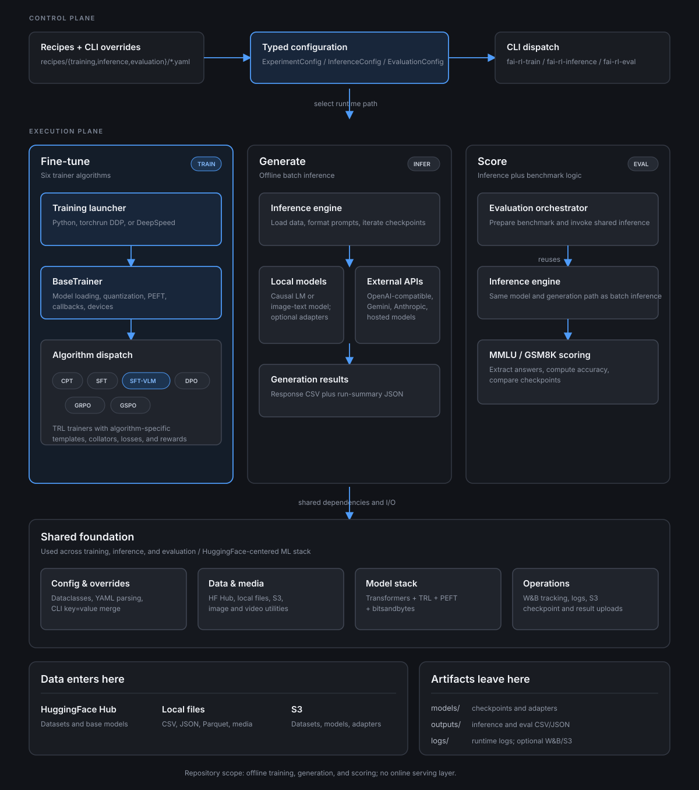

# FAI-RL: Foundation AI - Reinforcement Learning Library

<div align="center" style="line-height: 1;">
  <a href="https://www.apache.org/licenses/LICENSE-2.0"></a>
</div>

A production-ready framework for training, inference, evaluation using advanced reinforcement learning techniques. Built for researchers and practitioners who need a flexible, scalable solution for LLM fine-tuning.

## Architecture



## Overview

FAI-RL provides a unified, extensible framework for fine-tuning language models with the state-of-the-art algorithms:

- 🎯 **Supports Multiple RL Algorithms**: DPO, GRPO, GSPO implementations as well as support for Supervised Fine-Tuning (text and multimodal vision-language) and Continuous Pre-Training.
- 🚀 **Production Ready**: Tested on NVIDIA A100 and B200 GPU environments
- 📦 **Simple Configuration**: YAML-based configs with CLI override support
- ⚡ **Memory Efficient**: Full support for LoRA, QLoRA, and DeepSpeed ZeRO-3
- 🔧 **Highly Extensible**: Custom reward functions, dataset templates, and API integrations
- 🧩 **Write Your Own Loop**: `forward_backward` / `optim_step` primitives for custom objectives, with multi-GPU and checkpoints handled for you

## Table of Contents

- [Architecture](#architecture)
- [Installation](#-installation)
- [Authentication & Setup](#-authentication--setup)
- [Quick Start](#-quick-start)
  - [Training](#training)
  - [Inference](#inference)
  - [Evaluation](#evaluation)
- [Supported Methods](#supported-methods)
- [Write Your Own Training Loop](#write-your-own-training-loop)
- [Supported Models](#supported-models)
- [Key Features](#key-features)
- [Project Structure](#-project-structure)
- [S3 Checkpoint Upload](#-s3-checkpoint-upload)
- [Memory Optimization](#memory-optimization)
- [System Requirements](#-system-requirements)
- [License](#-license)

## 📦 Installation

FAI-RL does **not** pin `torch` in its package metadata, so it stays
cross-platform and never locks you to a single CUDA build. You install a
`torch`/`torchvision` build matching your host first, then install FAI-RL on
top. We recommend a dedicated conda environment.

### 1. Create a conda environment

```bash
conda create -n fai-rl python=3.12 -y
conda activate fai-rl
```

> Python 3.11–3.12 are supported.

### 2. Clone the repository

The training/inference/evaluation commands read recipe YAMLs that live in the
repo, so cloning is recommended even if you install from PyPI.

```bash
git clone https://github.com/Roblox/FAI-RL.git
cd FAI-RL
```

### 3. Install PyTorch (CUDA 13.0)

`requirements-cu130.txt` pulls `torch`/`torchvision` from the CUDA 13.0 wheel
index. For a different CUDA version, edit the index URL in that file (e.g.
`cu121`, `cu124`).

```bash
pip install -r requirements-cu130.txt
```

### 4. Install FAI-RL

```bash
# From source (editable) — recommended, includes the recipe YAMLs
pip install -e ".[cuda]"        # bitsandbytes, deepspeed, mpi4py

# ...or from PyPI
pip install "FAI-RL[cuda]"
```

> The `[cuda]` extra is Linux/NVIDIA only. On macOS, omit it: `pip install -e .`

> For faster GRPO/GSPO rollouts, add the `[vllm]` extra (also Linux/NVIDIA only):
> `pip install -e ".[cuda,vllm]"`. See [vLLM Rollouts](./trainers/README.md#vllm-rollouts).


> **Package**: [https://pypi.org/project/FAI-RL/](https://pypi.org/project/FAI-RL/)

## 🔑 Authentication & Setup

Before training or using models, you'll need to authenticate with HuggingFace and optionally set up experiment tracking with Weights & Biases.

### HuggingFace Authentication

Login to HuggingFace to access models and datasets:

```bash
huggingface-cli login
```

You'll be prompted to enter your HuggingFace access token. You can create a token at [https://huggingface.co/settings/tokens](https://huggingface.co/settings/tokens).

**What this enables:**
- Access gated models (if you have permission)


### Weights & Biases (Optional)

Login to Weights & Biases for experiment tracking and visualization:

```bash
wandb login
```

You'll be prompted to enter your W&B API key. Get your API key at [https://wandb.ai/authorize](https://wandb.ai/authorize).

For self-hosted or private W&B deployments, set `WANDB_BASE_URL` before training:

```bash
export WANDB_BASE_URL="https://your-wandb-instance.com"
```

The default value (`https://api.wandb.ai`) points to the public W&B cloud. This can also be set directly in the recipe under `wandb.base_url`.

> **Note**: W&B integration is optional. If not logged in, training will proceed without experiment tracking.

## 🚀 Quick Start

### Training

Train a model using any of the supported algorithms (CPT, SFT, SFT_VLM, DPO, GRPO, GRPO_VLM, GSPO, or your own loop):

```bash
# Single GPU training with LoRA
fai-rl-train --recipe recipes/training/sft/llama3_3B_lora.yaml --num-gpus 1

# Multi-GPU training with DeepSpeed
fai-rl-train --recipe recipes/training/dpo/llama3_3B_lora.yaml --num-gpus 8

# Override parameters from CLI
fai-rl-train --recipe recipes/training/sft/llama3_3B_lora.yaml --num-gpus 4 \
  training.learning_rate=5e-5 \
  training.num_train_epochs=3
```

📖 **[Complete Training Guide →](./trainers/README.md)**

### Inference

Generate text completions from trained or base models:

```bash
# Run inference on a trained model
fai-rl-inference --recipe recipes/inference/llama3_3B.yaml

# Use debug mode for detailed logging
fai-rl-inference --recipe recipes/inference/llama3_3B.yaml --debug
```

📖 **[Complete Inference Guide →](./inference/README.md)**

### Evaluation

Evaluate model performance on academic benchmarks (MMLU, GSM8K):

```bash
# Evaluate on MMLU benchmark
fai-rl-eval --recipe recipes/evaluation/mmlu/llama3_3B.yaml --debug
```

📖 **[Complete Evaluation Guide →](./evaluations/README.md)**

## Supported Algorithms

FAI-RL supports these training algorithms for language model fine-tuning (`training.algorithm`):

| Algorithm | Full Name | Description | Best For |
|-----------|-----------|-------------|----------|
| **CPT** | Continuous Pre-Training | Next-token prediction on raw text; no chat template | Domain adaptation, corpus ingestion |
| **SFT** | Supervised Fine-Tuning | Direct supervised learning from labeled examples | Instruction fine-tuning and foundational model fine-tuning |
| **SFT_VLM** | Multimodal Supervised Fine-Tuning | Supervised fine-tuning of vision-language models on `(image/video, text) -> response` data (supports multiple images or videos per row; set `image_columns` and/or `video_columns`) | Instruction-tuning VLMs, image and video understanding tasks |
| **DPO** | Direct Preference Optimization | Alignment via preference learning without explicit reward models | Human preference alignment, chat model training |
| **GRPO** | Group Relative Policy Optimization | Efficient preference learning with group-based comparison | Reasoning tasks, competitive response generation |
| **GRPO_VLM** | Multimodal GRPO | GRPO for vision-language models: a prompt plus one or more images per row (`image_columns`); the reward scores the text completion | Training VLM classifiers and graders against a reward |
| **GSPO** | Group Sequence Policy Optimization | Advanced sequence-level policy optimization | Complex multi-step reasoning, mathematical problem-solving |
| **CUSTOM** | Your Own Loop | Runs `training.entrypoint` (`module:function`), a loop written on the [`engine` primitives](#write-your-own-training-loop), with the launcher's multi-GPU, logging, and resume support | New objectives without subclassing a trainer |

### Training Engines

`training.backend` selects the engine that runs a recipe:

- `trl` (default) runs the TRL trainer classes for CPT, SFT, SFT_VLM, DPO, GRPO, GRPO_VLM, and GSPO.
- `native` runs text SFT on the [`engine` primitives](#write-your-own-training-loop) with the same YAML. The tests check that it reproduces the TRL losses. See `recipes/training/sft/llama3_3B_lora_native.yaml`.

CUSTOM always uses the native engine. It runs on one GPU or on several with `torchrun` (`--num-gpus N`), and does not support DeepSpeed. `training.micro_batch_tokens` caps the padded tokens per forward pass; leave it unset to run each micro-batch in one pass.

### Training Configurations

All algorithms support three efficiency modes:

| Mode | Memory Usage | Training Speed | Best For |
|------|-------------|---------------|----------|
| **Full Fine-tuning** | High (baseline) | Fastest | Small models (<3B params), maximum performance |
| **LoRA** | Low (~10% of full) | Fast | Most use cases, balanced efficiency |
| **QLoRA** | Very Low (~3-4GB for 7B model) | Moderate | Large models on consumer GPUs |

Additional features supported across all algorithms:
- ✅ Multi-GPU training with DeepSpeed ZeRO-3 (TRL engine) or `torchrun` data parallelism
- ✅ vLLM rollout generation for GRPO, GRPO_VLM, and GSPO, colocated on the training GPUs or on a separate server
- ✅ Gradient checkpointing for memory efficiency
- ✅ Custom reward functions and dataset templates
- ✅ Weights & Biases integration for experiment tracking
- ✅ Automatic S3 checkpoint upload (supports S3-compatible stores)

## Write Your Own Training Loop

The `engine` package is a small training API for writing your own loop. You write the loop and the loss. FAI-RL loads the model (LoRA, QLoRA, or full fine-tuning, from the Hub or S3), runs the forward and backward passes, and steps the optimizer. It also syncs gradients across GPUs and writes checkpoints. Calls are synchronous and run in your own process on your own GPUs.

| Call | What it does |
|------|--------------|
| `types.Datum(model_input, loss_fn_inputs)` | One example: the tokens the model reads plus every tensor its loss needs |
| `client.forward_backward(data, "cross_entropy")` | Adds the gradients of a registered loss |
| `client.forward_backward_custom(data, loss_fn)` | Adds the gradients of any `loss_fn(data, logprobs) -> (loss, metrics)` |
| `client.forward(data, loss_fn=None)` | Log-probs and loss metrics without gradients, for evaluation |
| `client.optim_step(types.AdamParams(...))` | Applies the summed gradients with AdamW, then clears them |
| `client.save_state(name)` / `client.load_state(path)` | Weights plus optimizer state, for resuming |
| `client.save_weights_for_sampler(name)` | Weights only, loadable with `from_pretrained` and `fai-rl-inference` |

### A minimal SFT loop

```python
import engine
from engine import types

service = engine.ServiceClient(output_dir="models/my-sft")
client = service.create_lora_training_client("Qwen/Qwen3-4B-Instruct-2507", rank=16)
tokenizer = client.get_tokenizer()


def make_datum(prompt_ids, completion_ids):
    """Train on the completion only. Position i reads ids[i] and predicts ids[i + 1]."""
    ids = prompt_ids + completion_ids
    weights = [0.0] * len(prompt_ids) + [1.0] * len(completion_ids)
    return types.Datum(
        model_input=types.ModelInput.from_ints(ids[:-1]),
        loss_fn_inputs={"target_tokens": ids[1:], "weights": weights[1:]},
    )


def encode(tokenizer, prompt, completion):
    prompt = tokenizer.apply_chat_template(
        [{"role": "user", "content": prompt}], tokenize=False, add_generation_prompt=True
    )
    return make_datum(
        tokenizer(prompt, add_special_tokens=False)["input_ids"],
        tokenizer(completion, add_special_tokens=False)["input_ids"] + [tokenizer.eos_token_id],
    )


for step, batch in enumerate(batches):  # each batch: (prompt, completion) pairs, same on every rank
    data = [encode(tokenizer, p, c) for p, c in engine.shard_for_rank(batch)]
    tokens = engine.all_reduce_sum(sum(d.loss_fn_inputs["weights"].sum().item() for d in data))
    for d in data:
        d.loss_fn_inputs["weights"] /= tokens  # mean over the trained tokens of the whole batch
    out = client.forward_backward(data, "cross_entropy")
    client.optim_step(types.AdamParams(learning_rate=1e-4, grad_clip_norm=1.0))
    print(step, engine.all_reduce_sum(out.metrics["loss:sum"]))

client.save_state("checkpoint-100")      # models/my-sft/checkpoint-100, resumable
client.save_weights_for_sampler("final")  # models/my-sft/final, for inference
```

Losses are sums, so scale `weights` to get a mean. The same script runs on 8 GPUs with `torchrun --nproc_per_node=8 my_sft.py`. Each rank trains on its `shard_for_rank` slice of the batch and `optim_step` sums the gradients over all ranks, so the result does not depend on the number of GPUs.

For QLoRA or full fine-tuning, create the client with `service.create_training_client(ModelConfig(...))`. To resume, use `service.create_training_client_from_state_with_optimizer(path)` (or `create_training_client_from_state(path)` to keep only the weights).

### Custom losses

`forward_backward_custom` passes your function each datum's log-probs of its `target_tokens`, and the loss may couple datums. This SimPO-style preference loss compares the chosen and rejected completion of each pair:

```python
import torch
import torch.nn.functional as F


def simpo_loss(data, logprobs, beta=2.0, gamma=0.5, scale=1.0):
    """data = [chosen_0, rejected_0, chosen_1, rejected_1, ...]"""
    avg_logprob = torch.stack([
        (lp * d.loss_fn_inputs["weights"]).sum() / d.loss_fn_inputs["weights"].sum()
        for d, lp in zip(data, logprobs)
    ]).view(-1, 2)
    margin = beta * (avg_logprob[:, 0] - avg_logprob[:, 1]) - gamma
    loss = -F.logsigmoid(margin).sum() * scale
    return loss, {"loss:sum": loss.item(), "accuracy:sum": (margin > 0).sum().item()}


data = [encode(tokenizer, p, c) for p, chosen, rejected in pairs for c in (chosen, rejected)]
data = engine.shard_for_rank(data, group_size=2)  # keep each pair on one rank
client.forward_backward_custom(data, lambda d, lp: simpo_loss(d, lp, scale=1 / len(pairs)))
```

`target_tokens` may also have shape `(N, K)` to score `K` candidate tokens per position, for example `" A"` and `" B"` for a judge. When a batch exceeds `micro_batch_tokens`, the client computes custom-loss gradients in two passes, and the result is unchanged. A loss that is a plain sum over datums can be registered with `@engine.register_loss("name", separable=True)` and then called by name in `forward_backward`.

### Run your loop from a recipe (`algorithm: custom`)

To get the recipe features without writing them yourself, implement a `SupervisedObjective` and point a recipe at it. `run_supervised` supplies the global batching, the linear warmup and decay schedule, logging and W&B, held-out eval loss, early stopping, `checkpoint-<step>` saves with S3 upload, and `--auto-resume`:

```python
# my_project/simpo.py
from functools import partial

from engine.cookbook.common import SupervisedObjective, run_supervised
from utils.dataset_utils import load_raw_dataset

# encode() and simpo_loss() as defined in the examples above.


class SimPO(SupervisedObjective):
    def __init__(self, config, tokenizer, logger):
        self.config, self.tokenizer = config, tokenizer

    def load_rows(self):  # rows with prompt / chosen / rejected columns
        return load_raw_dataset(self.config.data.datasets[0])

    def _data(self, rows):
        return [encode(self.tokenizer, r["prompt"], r[k]) for r in rows for k in ("chosen", "rejected")]

    def count_units(self, rows):  # the loss is averaged over pairs
        return len(rows)

    def train_step(self, client, rows, scale):
        out = client.forward_backward_custom(self._data(rows), partial(simpo_loss, scale=scale))
        return out.metrics["loss:sum"]

    def eval_step(self, client, rows):
        return client.forward(self._data(rows), simpo_loss).metrics["loss:sum"]


def run(config, logger):
    return run_supervised(config, logger, SimPO)
```

```yaml
training:
  algorithm: "custom"
  entrypoint: "my_project.simpo:run"  # called as run(config, logger)
  output_dir: "models/my-simpo"
  per_device_train_batch_size: 2
  gradient_accumulation_steps: 8
  learning_rate: 1.0e-5
```

`fai-rl-train --recipe my_simpo.yaml --num-gpus 8` then runs it like any other recipe. For a completely hand-written loop, build the client from the recipe with `engine.model_loading.build_training_client(config, logger)` inside your entrypoint. `engine/cookbook/sft.py`, the native SFT loop, is a larger example.

## Supported Models

FAI-RL provides pre-configured recipes and has been validated with the following models:

| # | Model |
|---|-------|
| 1 | [Qwen3 30B A3B Instruct (2507)](https://huggingface.co/Qwen/Qwen3-30B-A3B-Instruct-2507) |
| 2 | [Qwen3.6 27B](https://huggingface.co/Qwen/Qwen3.6-27B) |
| 3 | [Gemma 4 31B](https://huggingface.co/google/gemma-4-31B-it) |
| 4 | [Gemma 4 26B A4B IT](https://huggingface.co/google/gemma-4-26B-A4B-it) |
| 5 | [Qwen3-VL 30B A3B](https://huggingface.co/Qwen/Qwen3-VL-30B-A3B-Instruct) |
| 6 | [Qwen3 8B](https://huggingface.co/Qwen/Qwen3-8B) |
| 7 | [Qwen3 4B](https://huggingface.co/Qwen/Qwen3-4B-Instruct-2507) |
| 8 | [Llama 3.2 3B](https://huggingface.co/meta-llama/Llama-3.2-3B-Instruct) |
| 9 | [Llama 3.1 8B](https://huggingface.co/meta-llama/Llama-3.1-8B-Instruct) |

## Key Features

### 🎯 Flexible Configuration System
- **YAML-based recipes** with comprehensive inline documentation for all parameters
- **CLI overrides** for runtime parameter changes without editing files
- **Pre-configured templates** for popular models (Llama 3, Qwen 3, etc.)
- **Easy experimentation** with hyperparameter tuning

### 🔧 Extensible Architecture

**Custom Reward Services:**
- GRPO and GSPO reward calculation uses a configured HTTP API in production
- Prompts, completions, and dataset context are scored outside the training code
- Retries, timeouts, headers, and response fields are recipe-driven
- FAI-RL development tests can import a local Python reward callable from YAML

**Tool-Calling SFT:**
- Text SFT trains on OpenAI-format conversations with tool calls and results
  (`data.messages_column`, optional per-row `data.tools_column`)
- Loss covers only assistant turns, on any chat template; tool results are context
- See [Tool-Calling SFT](trainers/README.md#tool-calling-sft)

**Dataset Templates:**
- `GSM8KTemplate` - Math problem formatting with chain-of-thought
- `OpenMathInstructTemplate` - Mathematical instruction formatting

**Pluggable Components:**
- [`engine` training primitives](#write-your-own-training-loop) for custom losses and loops (`algorithm: custom`)
- Extensible trainer base classes for new algorithms
- HuggingFace Transformers and TRL integration
- Custom dataset processing pipelines

### 🌐 Multi-Provider API Support

Native support for commercial LLM APIs with automatic provider detection for inference and evaluation:

**Supported Providers:**
- 🤖 **OpenAI** (GPT-5, GPT-4.5, GPT-4.1, etc.)
- 🧠 **Google** (Gemini Pro, Gemini Flash)
- 💬 **Anthropic** (Claude 4.5 Sonnet, Opus, etc.)
- 🏠 **Hosted LLM** (self-hosted or custom endpoints)

**Configuration Example:**

```yaml
# OpenAI ChatGPT - provider detected from endpoint URL
inference:
  api_endpoint: "https://api.openai.com/v1/chat/completions"
  api_key: "sk-..."
  model: "gpt-4.1"  # Just the model name, no prefix needed!

# Google Gemini - provider detected from endpoint URL
inference:
  api_endpoint: "https://generativelanguage.googleapis.com/v1/models/gemini-pro:generateContent"
  api_key: "AIza..."
  model: "gemini-2.5-pro"

# Anthropic Claude - provider detected from endpoint URL
inference:
  api_endpoint: "https://api.anthropic.com/v1/messages"
  api_key: "sk-ant-..."
  model: "claude-sonnet-4-5-20250929"

# Hosted LLM - any custom or self-hosted model endpoint
inference:
  api_endpoint: "https://your-hosted-endpoint.com/v1/chat"
  api_key: "your-api-key"
  model: "your-model-name"
```

**Customization for Custom APIs:**

If your hosted LLM uses a non-OpenAI format, customize `utils/hosted_llm_config.py`:
- `build_hosted_llm_request()` - Modify request payload format
- `parse_hosted_llm_response()` - Customize response parsing
- `build_hosted_llm_headers()` - Adjust authentication headers

Each function includes detailed examples and inline documentation.


## 📁 Project Structure

```
FAI-RL/
├── core/                      # Core framework components
├── engine/                    # Training primitives (TrainingClient, Datum, losses)
│   └── cookbook/              # Native loops: SFT and the shared supervised loop
├── trainers/                  # Algorithm implementations
│   ├── rewards/               # Custom reward functions
│   │   ├── accuracy_rewards.py
│   │   └── format_rewards.py
│   └── templates/             # Dataset formatting templates
│       ├── gsm8k_template.py
│       └── openmathinstruct_template.py
├── inference/                 # Inference system
├── evaluations/               # Evaluation system
│   └── eval_datasets/         # Dataset-specific evaluation logic
│       ├── mmlu.py
│       └── gsm8k.py
├── recipes/                   # YAML configuration files
│   ├── training/              # Training recipes (cpt/, sft/, sft_vlm/, dpo/, grpo/, grpo_vlm/, gspo/)
│   ├── inference/             # Inference recipes
│   └── evaluation/            # Evaluation recipes (mmlu/, gsm8k/)
├── configs/                   # DeepSpeed configurations
│   └── deepspeed/             # ZeRO-3 configs for 1/2/4/8 GPUs
├── utils/                     # Shared utilities
│   ├── s3_utils.py            # S3 checkpoint upload callback
│   └── hosted_llm_config.py   # Custom API endpoint configuration
└── [auto-generated]
    ├── models/                # Trained model checkpoints
    ├── outputs/               # Inference and evaluation results
    └── logs/                  # Training logs
```

## ☁️ S3 Checkpoint Upload

FAI-RL can automatically upload checkpoints and the final fine-tuned model to Amazon S3 (or any S3-compatible store such as MinIO). Uploads run in background threads so they never block training.

### Prerequisites

Configure AWS credentials using any standard method (environment variables, `~/.aws/credentials`, IAM role, etc.):

```bash
# Option 1: Environment variables
export AWS_ACCESS_KEY_ID="..."
export AWS_SECRET_ACCESS_KEY="..."
export AWS_DEFAULT_REGION="us-east-1"

# Option 2: AWS CLI
aws configure
```

### Configuration

Add an `s3` section to your training recipe YAML:

```yaml
s3:
  enabled: true                                          # Enable S3 upload
  bucket: "your-s3-bucket"                               # S3 bucket name
  prefix: "your-s3-prefix"                               # Key prefix (folder path inside bucket)
  region: null                                           # AWS region (null = use default)
  endpoint_url: null                                     # Custom S3-compatible endpoint (e.g. MinIO)
  upload_checkpoints: true                               # Upload intermediate checkpoints (at every save_steps)
  upload_final_model: true                               # Upload the final model at end of training
  delete_local_after_upload: false                       # Delete local files after successful upload
```

| Parameter | Type | Default | Description |
|-----------|------|---------|-------------|
| `enabled` | bool | `false` | Master switch for the S3 upload feature |
| `bucket` | string | `""` | Target S3 bucket name (required when enabled) |
| `prefix` | string | `""` | Key prefix under which all uploads are stored |
| `region` | string | `null` | AWS region; falls back to `AWS_DEFAULT_REGION` or boto3 default |
| `endpoint_url` | string | `null` | Custom endpoint for S3-compatible stores (e.g. `http://minio:9000`) |
| `upload_checkpoints` | bool | `true` | Upload each intermediate checkpoint saved at `save_steps` intervals |
| `upload_final_model` | bool | `true` | Upload the final model directory at the end of training |
| `delete_local_after_upload` | bool | `false` | Remove local checkpoint directory after a successful upload |
| `run_fingerprint` | string | `""` | Run identity written into each checkpoint's upload manifest. Empty means a hash of the recipe; see [Resume After a Restart](#resume-after-a-restart) |

### How It Works

1. **Intermediate checkpoints** -- When the trainer saves a checkpoint (every `training.save_steps` steps), the S3 callback writes `eval_metrics.json` (held-out `eval_loss` for that step) into the checkpoint directory, uploads a compact `checkpoint_eval.json` index next to the checkpoint dirs, then uploads the entire checkpoint directory to `s3://<bucket>/<prefix>/checkpoint-<step>/` in a background thread.
2. **Final model** -- At the end of training, the output directory is uploaded to `s3://<bucket>/<prefix>/final/`.
3. **Non-blocking** -- All uploads happen on daemon threads. Training continues while files are being transferred. At the end of training, the callback waits for any remaining uploads to finish before the process exits.
4. **Upload manifest** -- When a resumable checkpoint (see below) finishes uploading, the callback writes `upload_manifest.json` last. It lists every uploaded file and its size, the step, the world size, and the run fingerprint. A checkpoint without one was model-only or did not finish uploading.

### Resume After a Restart

A job that is preempted or loses a node restarts on fresh disks, so its local checkpoints are gone. Run the same command again with `--auto-resume`, and FAI-RL downloads the newest checkpoint it can resume from `s3://<bucket>/<prefix>/` into `training.output_dir` before training starts:

```bash
fai-rl-train --recipe recipes/my_recipe.yaml --auto-resume
```

A checkpoint is restored only if:

- it has an `upload_manifest.json` and every file it lists downloaded at the listed size;
- the same recipe wrote it, ignoring `training.resume_from_checkpoint` and `training.deepspeed_config` (set `s3.run_fingerprint` to the same string in both recipes to resume after changing the recipe);
- it was saved at the same world size as this run.

Otherwise FAI-RL tries the next older checkpoint, and starts fresh if none qualifies. An explicit `training.resume_from_checkpoint` turns the S3 restore off. On a resumed run, `checkpoint_eval.json` keeps the eval losses of the checkpoints before the resumed step.

With early stopping, the best checkpoint so far is restored too, because `load_best_model_at_end` reloads it after the last step. If it cannot be restored, the run ends with its last model instead of the best one.

Requirements and limits:

- Set `training.save_only_model: false`. Model-only checkpoints have no optimizer or scheduler state and are uploaded without a manifest.
- A multi-node DeepSpeed run resumes only if `output_dir` is on a filesystem shared by every node. Otherwise rank 0 sees only its own node's optimizer shards, and those checkpoints get no manifest.
- The native engine (`training.backend: native`, `algorithm: custom`) does not write manifests yet, so it resumes only from local checkpoints.

Loading a checkpoint's weights from S3, for inference or as `model.base_model_name`, skips the optimizer, scheduler, RNG, and DeepSpeed state files.

### S3 Upload Structure

Given the example config above, the resulting S3 layout would be:

```
s3://your-s3-bucket/
└── checkpoints/qwen3-4B-inst-dpo-lora-150k/
    ├── checkpoint-100/
    │   ├── adapter_config.json
    │   ├── adapter_model.safetensors
    │   ├── eval_metrics.json          # eval_loss at this step
    │   ├── upload_manifest.json       # written last; resumable checkpoints only
    │   └── ...
    ├── checkpoint-200/
    │   └── ...
    ├── checkpoint_eval.json           # all checkpoint eval_loss scores
    └── final/
        ├── adapter_config.json
        ├── adapter_model.safetensors
        └── ...
```

## Memory Optimization

FAI-RL provides multiple techniques for efficient training of large models on limited hardware:

### Optimization Techniques

| Technique | Memory Savings | Speed Impact | Configuration |
|-----------|---------------|--------------|---------------|
| **LoRA** | ~90% reduction | Minimal | `use_lora: true` + LoRA params |
| **QLoRA** | ~95% reduction | Moderate | `load_in_4bit: true` + LoRA params |
| **8-bit Quantization** | ~50% reduction | Minimal | `load_in_8bit: true` |
| **Gradient Checkpointing** | ~30-50% reduction | 20% slower | `gradient_checkpointing: true` |
| **DeepSpeed ZeRO-3** | Distributed across GPUs | Varies | Auto-enabled for multi-GPU |


### Optimization Strategy

1. **Start with QLoRA** if GPU memory is limited (<16GB)
2. **Use LoRA** for balanced efficiency on mid-range GPUs (16-40GB)
3. **Full fine-tuning** only for small models or high-end GPUs (80GB+)
4. **Enable gradient checkpointing** if still encountering OOM errors
5. **Use DeepSpeed ZeRO-3** for multi-GPU setups to distribute memory load

## 🧪 System Requirements

### Validated on Hardware

This framework has been tested on NVIDIA A100 and B200 GPUs.

#### A100 Environment

* **Instance:** AWS EC2 p4d.24xlarge
* **GPUs:** 8 x NVIDIA A100-SXM4-80GB (80GB VRAM each)
* **CPU:** 96 vCPUs
* **Memory:** 1152 GiB
* **Storage:** 8TB NVMe SSD
* **Network:** 400 Gbps

#### B200 Environment

* **Instance:** AWS EC2 p6-b200.48xlarge
* **GPUs:** 8 x NVIDIA B200 (180GB HBM3e each)
* **CPU:** 192 vCPUs
* **Memory:** 2048 GiB
* **Storage:** 8TB NVMe SSD
* **Network:** 3.2 Tbps

## 📄 License

This project is licensed under the Apache License 2.0 - see the [LICENSE](LICENSE) file for details.

Licensed under the Apache License, Version 2.0 (the "License");
you may not use this file except in compliance with the License.
You may obtain a copy of the License at

    http://www.apache.org/licenses/LICENSE-2.0

Unless required by applicable law or agreed to in writing, software
distributed under the License is distributed on an "AS IS" BASIS,
WITHOUT WARRANTIES OR CONDITIONS OF ANY KIND, either express or implied.
See the License for the specific language governing permissions and
limitations under the License.

## For Maintainers

<details>
<summary>Publishing a New Release</summary>

Releases must be published from the repository's
[GitHub Releases page](https://github.com/Roblox/FAI-RL/releases). Publishing
a GitHub release triggers `.github/workflows/python-publish.yml`, which builds
the distributions and uploads them to PyPI.

1. **Update and merge the version** in `pyproject.toml`:
```toml
[project]
name = "FAI-RL"
version = "X.Y.Z"  # Increment version
```

2. Open [GitHub Releases](https://github.com/Roblox/FAI-RL/releases), select
   **Draft a new release**, and create tag `vX.Y.Z` from the merged `main`
   branch.
3. Use `vX.Y.Z` as the release title, add concise release notes, and select
   **Publish release**.
4. Verify the **Upload Python Package** workflow succeeds and that version
   `X.Y.Z` is available from [PyPI](https://pypi.org/project/FAI-RL/) before
   consumers pin or deploy it.

The tag and `pyproject.toml` version must match. PyPI versions are immutable,
so do not reuse a version after it has been published.
</details>
